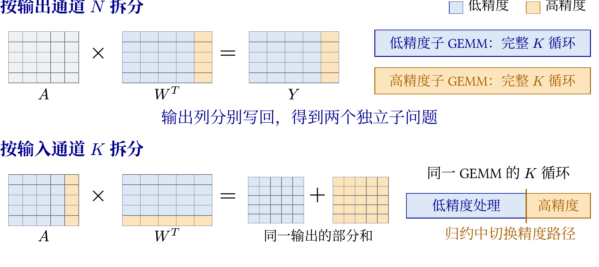
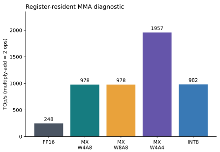
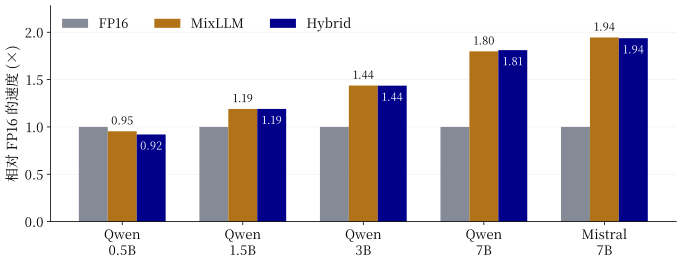
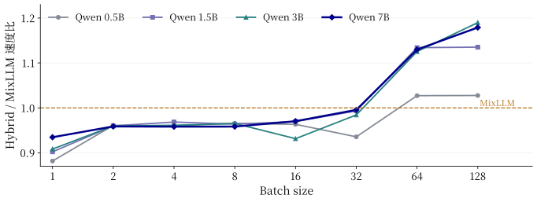
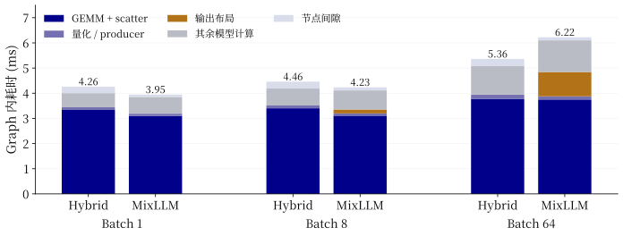
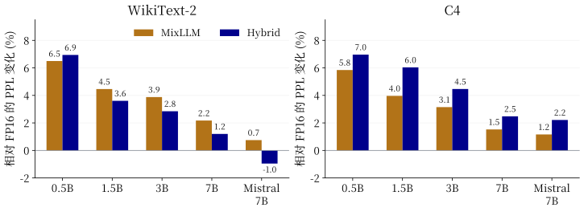
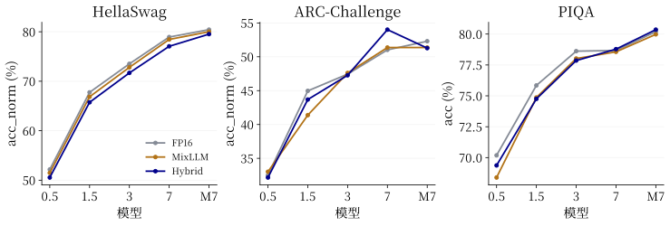

# HybridGEMM

面向 NVIDIA Blackwell SM120 的输出通道混合精度 GEMM：以 **MXFP4 权重 × MXFP8 激活**为主路径，为重要输出通道保留 **MXFP8 × MXFP8**，并接入 vLLM 完成模型推理。

## 动机 从输入通道切分到输出通道切分

最初的探索是在矩阵乘法的归约过程中，把部分输入通道切片升级为高精度。这意味着同一个输出要汇总不同精度路径的部分和，还要在 K 循环内处理精度切换、数据布局与流水线衔接。

MixLLM 提供了另一个方向：**按输出通道分配精度**。每个子 GEMM 都能执行完整、统一精度的 K 循环，两部分输出互不重叠，可以独立计算并按原通道索引写回。

图中上半部分按输出通道 N 切分，得到两个独立子问题；下半部分按输入通道 K 切分，需要累加同一输出的部分和。HybridGEMM 采用前者，将研究重点转向浮点通道选择和两条计算路径的执行效率。

SM120 原生支持混合低精度浮点 MMA，因此主路径可以直接执行 FP4×FP8，省去 MixLLM 将 INT4 软件解包为 INT8 的步骤，以及组级整数转浮点、缩放累加所需的辅助处理与中间缓冲。减少这些指令和寄存器需求，是本项目探索性能收益的出发点。

## 启发工作 MixLLM

[MixLLM](https://arxiv.org/abs/2412.14590) 根据模型损失衡量输出通道的重要性，在全模型范围分配高精度通道：大部分权重采用 INT4，重要通道采用 INT8，并通过专用内核、快速转换与流水线组织实现高效推理。

- 原仓库：[microsoft/MixLLM](https://github.com/microsoft/MixLLM)
- 论文：[MixLLM: LLM Quantization with Global Mixed-precision between Output-features and Highly-efficient System Design](https://arxiv.org/abs/2412.14590)（MLSys 2026）

HybridGEMM 借鉴其输出通道分解，将整数计算替换为 SM120 原生混合浮点计算，并重新探索适合浮点量化误差的通道选择。

## MMA 吞吐 原生混合路径没有额外吞吐优势

首先测试操作数驻留寄存器时的 MMA 吞吐，比较 FP16、FP4×FP8、FP8×FP8、FP4×FP4 和 INT8×INT8。实验使用 RTX 5090，一次乘加计为两次运算。

FP4×FP8、FP8×FP8 和 INT8×INT8 分别约为 **978、978、982 TOp/s**，基本持平；FP4×FP4 约为 **1957 TOp/s**，是前者的两倍。由此，**“单侧使用 FP4 即可获得更高原生 MMA 吞吐”的假设被实验否定**。一种可能解释是 FP4×FP8 与 8-bit 乘法共享相近的 Tensor Core 计算资源和流水线。

因此，HybridGEMM 的优化重点是把软件解包、缩放缓冲和数据搬运的节省转化为完整推理收益，而不是依赖乘法指令本身更快。

## Hybrid 实现与最终效果

最终实现采用**双 kernel + scatter**：两个精度分区共用量化激活，分别计算并直接写入最终输出。两路按实际形状独立调优，并结合向量化 FP8 打包、SwiGLU 激活与量化融合，减少每步推理的额外工作。

质量侧在原权重编码预算内联合选择通道与 FP4 clipping：Qwen2.5-0.5B 使用 Absolute 评分和层间自由配额，其余三个规模使用 Signed 评分与固定各层配额，均采用输入加权 clipping。Mistral-7B 沿用较大模型的选择规则。以下统一将选定方案记为 **Hybrid**。

最终比较 FP16、MixLLM（原整数 kernel + RTN）与 Hybrid。公共环境为 RTX 5090、CUDA 13.0、vLLM 0.26.0，固定 FULL CUDA Graph、禁用 Inductor。Decode 覆盖 batch 1–128、prompt 长度 128 和 1024；质量采用 WikiText-2、C4 和三个下游任务。

### 整体 decode 速度

图中对不同 batch 与 prompt 的速度比取几何平均。Hybrid 在 Qwen2.5-1.5B、3B、7B 上相对 FP16 达到 **1.19×、1.44×、1.81×**，Mistral-7B 为 **1.94×**；与 MixLLM 的整体速度接近。0.5B 的两种量化实现都慢于 FP16，小模型更难摊薄量化与执行组织的额外成本。

### 收益主要来自大 batch

速度比大于 1 表示 Hybrid 更快。Qwen2.5-7B 在 batch 1–8、16–32、64–128 的速度比分别为 **0.952×、0.983×、1.154×**：大 batch 快约 **15.4%**，小 batch 仍较慢。其余 Qwen2.5 模型也呈现随 batch 增大而改善的趋势。

### 小 batch 的时间花在哪里

batch 1 时，Hybrid 的 GEMM 执行区间比 MixLLM 多约 **0.24 ms**，节点间隙多约 **0.16 ms**，软件解包的节省尚未抵消这些开销。batch 64 时，两者 GEMM 时间接近，而 MixLLM 还有约 **0.96 ms** 的额外输出布局处理；Hybrid 直接 scatter 写回，省下了这部分时间。batch 1 原本没有这项额外 copy，因此不会获得同样的收益。

### WikiText-2 与 C4 的语言建模质量

图中展示相对 FP16 的 PPL 变化，越低越好。Hybrid 在 1.5B、3B、7B 和 Mistral 的 WikiText-2 PPL 比 MixLLM 低 **0.82%–1.69%**，0.5B 略高；C4 上五个模型则均比 MixLLM 高 **0.94%–1.99%**。在 WikiText-2 校准与选型得到的质量改善，没有延续到另一种文本分布。

### 下游任务质量

HellaSwag 上，Hybrid 比 MixLLM 低 **0.49–1.38 个百分点**；ARC-Challenge 上，1.5B 和 7B 分别提高 **2.30、2.65 个百分点**；PIQA 整体接近。PPL 衡量平均预测损失，而选择题依赖候选答案的相对排序，同域 PPL 改善没有转化为一致的任务收益。

HybridGEMM 完成了从输出通道分解、原生混合浮点计算到完整模型推理的实现。实验说明，减少软件处理能够带来大 batch 的实际收益，但指令更直接并不自动意味着小 batch 更快，通道选择在一种语料上有效也不意味着跨任务质量同步提升。后续重点是缩短小 batch 的 GEMM 与节点等待，并让通道选择同时考虑多语料和任务排序目标。
